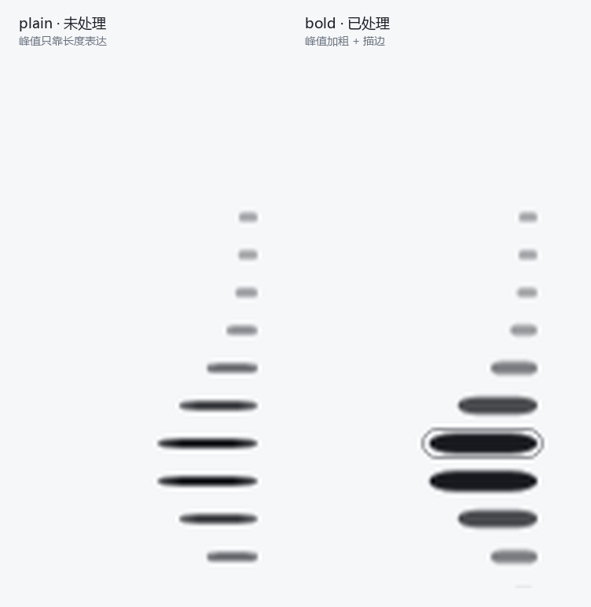
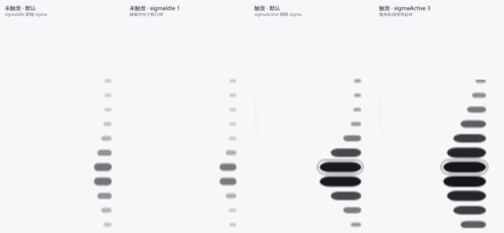
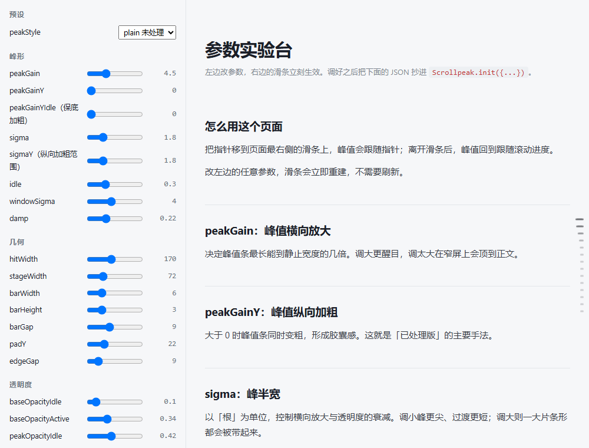

# Scrollpeak

> 一条贴在页面右侧的**单峰滑动指示条**：峰值跟随鼠标或滚动进度，逐帧只写 `transform` 与 `opacity`。
> 零依赖、单文件、可 CDN 直引。



<br>

| | |
|---|---|
| **大小** | `scrollpeak.min.js` 19.9 KB / gzip **7.4 KB** |
| **依赖** | 无运行时依赖 |
| **格式** | IIFE · ESM · CommonJS |
| **浏览器** | Chrome / Edge 88+、Safari 14+、Firefox 78+ |
| **许可** | MIT |

<br>

**两种开箱形态**

```js
Scrollpeak.init();                          // plain —— 峰值只靠长度表达
Scrollpeak.init({ peakStyle: 'bold' });     // bold  —— 峰值加粗 + 描边
```

**在线试玩**：克隆后打开 `examples/index.html`，或用
`examples/playground.html` 实时调全部 57 个参数。

---

## 目录

- [特性](#特性)
- [快速开始](#快速开始)
- [用法](#用法)
- [预设](#预设)
- [全部可调参数](#全部可调参数)
- [API](#api)
- [性能](#性能)
- [无障碍](#无障碍)
- [浏览器支持](#浏览器支持)
- [示例](#示例)
- [开发与发布](#开发与发布)
- [路线图](#路线图)
- [License](#license)

---

## 特性

- **单峰**：所有条形静止宽度一致，宽度差异只来自峰值本身，不会出现「假峰」
- **两种形态**：`plain`（只靠长度）与 `bold`（峰值加粗 + 描边），可随时切换
- **明暗自适应**：读取页面背景亮度，浅色页面用灰黑条形，深色页面用灰白条形
- **未触发时跟随滚动**：指针不在轨道上时，峰值对应页面滚动进度；进入轨道后改为跟随指针
- **提示卡**：触发时在左侧弹出只含标题的提示卡，并高亮正文里对应的标题
- **点击跳转**：点击轨道任意位置平滑滚动到对应章节
- **键盘可用**（可选）：方向键 / PageUp / PageDown / Home / End / Enter
- **多实例**：同页可创建多个实例，样式各自隔离
- **性能取向**：逐帧只写合成器属性；窗口化更新让开销与文档长度脱钩；静止即停机
- **零依赖**：无构建步骤也能用，`<script>` 直接引

---

## 快速开始

### 1. `<script>` 直接引（推荐）

```html
<main data-scrollpeak>
  <section><h2>第一章</h2> …</section>
  <section><h2>第二章</h2> …</section>
  <section><h2>第三章</h2> …</section>
</main>

<script src="https://cdn.jsdelivr.net/npm/scrollpeak/dist/scrollpeak.min.js"></script>
<script>
  Scrollpeak.init();                 // 默认 plain
</script>
```

### 2. 下载到本地

```html
<script src="./dist/scrollpeak.min.js"></script>
```

### 3. ESM / 打包器

```js
import Scrollpeak from 'scrollpeak';

const sp = Scrollpeak.init({ peakStyle: 'bold' });
```

### 4. CommonJS

```js
const Scrollpeak = require('scrollpeak');
Scrollpeak.init({ container: '#toc' });
```

---

## 用法

### 标记结构

组件默认扫描 `[data-scrollpeak]` 容器的**直接子元素**，从每个子元素里的第一个标题取文案：

```html
<main data-scrollpeak>
  <section>
    <h2>这一段的标题</h2>          <!-- 取这里的文字 -->
    <p>正文…</p>
  </section>
  <section data-sp-title="自定义文案">
    <h2>会被 data-sp-title 覆盖</h2>
  </section>
  <section data-sp-skip>           <!-- 整段跳过，不生成条形 -->
    <h2>不参与导航</h2>
  </section>
</main>
```

| 属性 | 作用 |
|---|---|
| `data-scrollpeak` | 条目容器（可用 `container` 参数换成任意选择器或 Element） |
| `data-sp-title` | 覆盖该条目的提示卡文案 |
| `data-sp-skip` | 该子元素不参与导航 |

条目少于 `minItems`（默认 3）时组件不会渲染，`init()` 返回 `null`。

容器没命中时，会退化为扫描整页的 `h2`（可用 `heading` 改）。

### 也可以直接传条目

```js
Scrollpeak.init({
  items: [
    { el: document.querySelector('#a'), t: '第一章' },
    { el: '#b', t: '第二章' }        // 也接受选择器字符串或 Element
  ]
});
```

### 自动初始化所有容器

```js
Scrollpeak.auto({ peakStyle: 'bold' });   // 给每个 [data-scrollpeak] 各建一个实例
```

---

## 预设

预设只是「一组默认值」，显式传入的参数永远覆盖预设。

| 预设 | 参数 | 适用场景 |
|---|---|---|
| `plain` | 无额外覆盖，即默认值 | 阅读型长文，滑条尽量不抢视线 |
| `bold` | `peakGain: 5` · `peakGainY: 1.2` · `sigma: 1.6` · `peakRing: true` | 章节多、标题长，需要一眼定位 |

```js
const sp = Scrollpeak.init({ peakStyle: 'bold' });

// 运行时切换（会整体重算参数，预设带进来的值能干净地还原）
sp.setOptions({ peakStyle: 'plain' });

// 只要加粗、不要描边
sp.setOptions({ peakStyle: 'bold', peakRing: false });

// 只要描边、不要加粗
sp.setOptions({ peakStyle: 'plain', peakRing: true, peakGainY: 0 });
```

---

## 全部可调参数

在 `Scrollpeak.init({...})` 里传，或在 `setOptions({...})` 里改。
`Scrollpeak.defaults` 是默认值对象，`Scrollpeak.presets` 是预设对象。

### 内容

| 参数 | 类型 | 默认值 | 说明 |
|---|---|---|---|
| `container` | `string \| Element` | `'[data-scrollpeak]'` | 条目容器。选择器或元素本身 |
| `heading` | `string` | `'h2'` | 容器没命中时的兜底扫描选择器 |
| `items` | `Array` | `null` | 直接传条目：`[{el, t}]` / `[Element]` / `['#sel']` |
| `minItems` | `number` | `3` | 条目少于此数不渲染，`init()` 返回 `null` |
| `titleAttr` | `string` | `'data-sp-title'` | 单条目文案覆盖属性名 |
| `skipAttr` | `string` | `'data-sp-skip'` | 带此属性的子元素跳过 |

### 几何

| 参数 | 类型 | 默认值 | 说明 |
|---|---|---|---|
| `hitWidth` | `number` | `170` | 触发区（悬停 / 点击）宽度，px。会自动放大到不小于 `stageWidth` |
| `stageWidth` | `number` | `72` | 条形可视宽度，px |
| `barWidth` | `number` | `6` | 条形**静止**宽度，px（统一值 → 只有一个峰） |
| `barHeight` | `number` | `3` | 条形高度，px |
| `barGap` | `number` | `9` | 条形间距，px |
| `padY` | `number` | `22` | 触发范围在条形上下各留的余量，px（只影响触发区，不影响条形位置） |
| `edgeGap` | `number` | `9` | 轨道距页面右边缘的距离，px |

> 轨道总高 = `N × barHeight + (N − 1) × barGap + 2 × padY`，并始终在视口垂直居中。

### 峰形

| 参数 | 类型 | 默认值 | 说明 |
|---|---|---|---|
| `peakStyle` | `'plain' \| 'bold'` | `'plain'` | 预设名，等价于一次性套用一组参数 |
| `peakGain` | `number` | `4.5` | 峰值横向放大倍数（最终宽度 = `barWidth × (1 + peakGain)`） |
| `peakGainY` | `number` | `0` | 峰值纵向加粗倍数（0 = 不加粗；`bold` 预设为 1.2）。随触发强度增长 |
| `peakGainYIdle` | `number` | `0` | 峰值条的**保底**加粗量，与触发强度无关、恒定叠加。用于让「未触发时也能看出峰在哪」 |
| `sigma` | `number` | `1.8` | **峰半宽基准值**（单位「根」）。下面四个没设时都跟随它 |
| `sigmaIdle` | `number \| null` | `null` | **未触发时**的横向峰半宽（驱动横向放大与透明度）。`null` = 跟随 `sigma` |
| `sigmaActive` | `number \| null` | `null` | **触发时**的横向峰半宽。`null` = 跟随 `sigma` |
| `sigmaY` | `number \| null` | `null` | 简写：一次性设定 `sigmaYIdle` 与 `sigmaYActive` |
| `sigmaYIdle` | `number \| null` | `null` | **未触发时**纵向加粗的峰半宽。`null` = 跟随 `sigmaIdle` |
| `sigmaYActive` | `number \| null` | `null` | **触发时**纵向加粗的峰半宽。`null` = 跟随 `sigmaActive` |
| `idle` | `number` | `0.3` | 未触发时的强度 0–1（0 = 完全躺平，1 = 与触发时一样醒目） |
| `windowSigma` | `number` | `4` | **性能开关**：每帧只重算峰值 ±`windowSigma × max(四个 sigma)` 根条形 |
| `damp` | `number` | `0.22` | 阻尼系数，越大跟手越快、越小越柔和 |
| `settleEps` | `number` | `0.0006` | 收敛阈值，低于此值停止 rAF 循环 |

> `windowSigma` 调得比 3 还小时，峰的两侧可能被截断出现硬边；
> 调到 4 以上只是白算更多条形。

**四条衰减曲线**

峰形由四条高斯曲线决定，每条都分「未触发 / 触发」两个取值：



| 曲线 | 参数 | 影响 |
|---|---|---|
| 横向 | `sigmaIdle` / `sigmaActive` | 横向放大（长度）与透明度 |
| 纵向 | `sigmaYIdle` / `sigmaYActive` | 纵向加粗（粗细） |

- 四个值默认全部跟随 `sigma`（= 1.8），此时行为与「只有一个 sigma」完全一致。
- `sigmaY` 是简写，一次性设定纵向的两个值；单独设 `sigmaYIdle` / `sigmaYActive` 时以分项为准。
- 混合用的是**归一化强度** `k = (t − idle) / (1 − idle)`：
  未触发时恰好 `0`，完全触发时恰好 `1`。
  所以你填的 `*Idle` / `*Active` 就是在这两个状态下**实际看到的取值**，
  中间的过渡只是在这两条曲线之间平滑插值。

```js
// 未触发时峰更尖、更集中在少数几根；触发后摊开成一片
Scrollpeak.init({
  peakStyle: 'bold',
  sigmaIdle: 1.0,  sigmaActive: 2.6,   // 横向
  sigmaYIdle: 1.2, sigmaYActive: 3.0   // 纵向
});
```

**未触发时峰值为什么看不出来**：未触发时强度只有 `idle`（默认 0.3），
纵向加粗只有 `peakGainY × idle` = 1.2 × 0.3 = 36%（3px → 4px）。
`sigma*Idle` 只决定「这些加粗量分给多少根条形」，改不了中心有多粗；
要让未触发时的峰更明显，用 `peakGainYIdle`（只加粗，不影响长度与透明度）
或调大 `idle`（长度、粗细、透明度一起变强）。

### 外观

| 参数 | 类型 | 默认值 | 说明 |
|---|---|---|---|
| `theme` | `'auto' \| 'light' \| 'dark'` | `'auto'` | `auto` 时按页面背景亮度自动判断 |
| `inkLight` | `string` | `'#111318'` | 浅色页面用的条形颜色 |
| `inkDark` | `string` | `'#e9ecf1'` | 深色页面用的条形颜色 |
| `baseOpacityIdle` | `number` | `0.1` | 未触发时**非峰值条**的透明度 |
| `baseOpacityActive` | `number` | `0.34` | 触发时非峰值条的透明度 |
| `peakOpacityIdle` | `number` | `0.42` | 未触发时**峰值条**的透明度 |
| `peakOpacityActive` | `number` | `1` | 触发时峰值条的透明度 |
| `peakRing` | `boolean` | `false` | 峰值条描边（`bold` 预设开启） |
| `peakRingWidth` | `number` | `1` | 描边线宽，px |
| `peakRingGap` | `number` | `1` | 描边与条形之间的空隙，px |
| `peakRingColor` | `string \| null` | `null` | `null` = 按明暗主题自动取色 |
| `peakGlow` | `boolean` | `false` | 峰值发光（`box-shadow`，随 transform 一起缩放，零额外写入） |
| `layer` | `'container' \| 'bar' \| 'none'` | `'container'` | 合成层策略，见下 |
| `zIndex` | `number` | `2147483000` | 轨道层级 |

`layer` 的三种取值：

| 取值 | 含义 | 建议 |
|---|---|---|
| `container` | 只把整条轨道提升为一个合成层 | 默认。条目多时内存最省 |
| `bar` | 每根条形各一个图层（`will-change`） | 条目少（< 30）且追求极致顺滑时 |
| `none` | 不做图层提升 | 页面已有大量合成层、想主动让路时 |

### 交互

| 参数 | 类型 | 默认值 | 说明 |
|---|---|---|---|
| `clickToScroll` | `boolean` | `true` | 点击轨道跳转到对应章节 |
| `scrollBehavior` | `string` | `'smooth'` | 传给 `scrollIntoView` 的 `behavior` |
| `cursor` | `string` | `'pointer'` | 轨道上的光标样式 |
| `showPeek` | `boolean` | `true` | 是否显示提示卡 |
| `peekGap` | `number` | `18` | 提示卡与轨道的水平间距，px |
| `peekMaxWidth` | `number` | `240` | 提示卡最大宽度，px |
| `peekThreshold` | `number` | `0.4` | 峰值强度超过此值才显示提示卡 |
| `keyboard` | `boolean` | `false` | 开启方向键 / PageUp / PageDown / Home / End / Enter，并加上 `role="slider"` 与 `aria-*` |
| `activeClass` | `string` | `'sp-active'` | 加到当前条目标题上的类名 |
| `activeColor` | `string` | `'#0b7f8c'` | 当前条目标题的高亮色 |

### 回调

| 参数 | 类型 | 说明 |
|---|---|---|
| `onEngage` | `function` | 指针进入轨道 |
| `onLeave` | `function` | 指针离开轨道 |
| `onActive` | `function(index, item)` | 当前条目变化 |
| `onTheme` | `function('light' \| 'dark')` | 明暗判定结果变化 |

### 性能微调

| 参数 | 类型 | 默认值 | 说明 |
|---|---|---|---|
| `quantScale` | `number` | `256` | 缩放量化级数。跨过 `1/quantScale` 才写一次样式 |
| `quantOpacity` | `number` | `170` | 透明度量化级数 |

> 量化把连续的浮点值先变成整数再比较：跨级才写样式，稳态下零字符串分配。
> `256` 对应约 `0.004` 的位移，`170` 对应约 `0.006` 的透明度变化，都是肉眼难辨的量级。
> 调大更细腻但样式写入更频繁，调小更省但可能出现台阶感。

---

## API

```js
const sp = Scrollpeak.init(options);   // 条目不足 minItems 时返回 null
```

| 成员 | 说明 |
|---|---|
| `Scrollpeak.init(options)` | 创建一个实例 |
| `Scrollpeak.auto(options)` | 为页面上每个 `[data-scrollpeak]` 各建一个实例，返回数组 |
| `Scrollpeak.defaults` | 默认参数对象 |
| `Scrollpeak.presets` | `{ plain, bold }` 预设对象 |
| `Scrollpeak.version` | 版本号 |
| `sp.setOptions(patch)` | 局部改参数：重建样式与几何，立即生效 |
| `sp.reset(keep?)` | 丢弃自定义参数回到默认值；`keep` 可保留其中若干项 |
| `sp.setTheme('auto'\|'light'\|'dark')` | 切换主题判定方式 |
| `sp.refresh()` | 内容变了之后重新扫描条目、重建条形 |
| `sp.scrollToIndex(i)` | 滚动到第 i 个条目 |
| `sp.state` | 只读状态：`{ engaged, active, target, current, intensity, dark, count, title }` |
| `sp.destroy()` | 移除 DOM、样式与全部监听器 |
| `sp.rail` | 轨道元素（`<aside>`），可自行加类名或挂事件 |

`setOptions` 会把参数**整体重算**（默认值 → 预设 → 你传入的），所以在预设之间来回切换不会残留上一次的参数。

---

## 性能

### 设计

| 手段 | 说明 |
|---|---|
| 只写合成器属性 | 逐帧只写 `transform` 与 `opacity`，不碰 `width` / `left` / `background-color` |
| 窗口化更新 | 每帧只重算峰值 ±`windowSigma × sigma` 根条形，开销与文档长度脱钩 |
| 量化 + 字符串查表 | 量化成整数再比较，跨级才写样式；`scale(...)` 字符串按量化值缓存，稳态零分配 |
| 单合成层 | 整条轨道一个图层，**不给每根条形加 `will-change`** |
| 几何缓存 | `getBoundingClientRect()` 只在初始化与尺寸变化时调用，逐帧零布局读取 |
| 主题检测去抖 | 背景没变就不重算，避免无谓的 `getComputedStyle` |
| 静止即停机 | 阻尼收敛后 rAF 循环直接退出，页面静止时主线程占用归零 |
| 早退 | 指针坐标没变就直接返回；提示卡只在切换条目时写入 |

### 实测

在同一页面、同一套埋点下对比「重构前的旧实现」与当前实现，多轮取中位数。
可直接复现：

```bash
npm run build
node bench/run.mjs 200 200      # N=200 条，每场景 200 帧
node bench/run.mjs 1000 200     # 大文档
BENCH_REPS=5 node bench/run.mjs 200 200
```

**N = 1000 条**（每场景 200 帧，5 轮取中位数）

| 指标 | 旧实现 | 新实现 | 变化 |
|---|---|---|---|
| 合成层（`will-change` 元素数） | 1000 | **1** | **−99.9%** |
| style 写入（指针连续扫过） | 9945 | 9732 | −2% |
| rAF 回调 CPU（指针连续扫过） | 29.4 ms | 27.9 ms | −5% |
| style 写入（指针原地 ±1.2px 抖动） | 5389 | 5016 | −7% |
| rAF 回调 CPU（抖动） | 18.5 ms | 18.5 ms | 0% |
| 每帧布局读取 / `getComputedStyle` | 0 / 0 | 0 / 0 | — |

**N = 200 条**

| 指标 | 旧实现 | 新实现 | 变化 |
|---|---|---|---|
| 合成层 | 200 | **1** | **−99.5%** |
| style 写入（指针连续扫过） | 6723 | 6661 | −1% |
| rAF 回调 CPU（指针连续扫过） | 约 21 ms | 约 21 ms | −4% ~ +8%（见下） |
| style 写入（指针原地 ±1.2px 抖动） | 3971 | 2898 | **−27%** |
| rAF 回调 CPU（抖动） | 9.6 ms | 9.0 ms | 噪声带内 |
| 初始化（布局读取 / 样式重算） | 2 / 2 | 1 / 3 | 打平 |

**怎么读这组数字（如实说明）**

- **最大的收益是图层数**：`1000 → 1`。这直接决定内存占用与合成开销，
  也是大文档下唯一会「炸」的指标——旧实现给每根条形都加了 `will-change`，
  1000 个条目就是 1000 个合成层。
- **样式写入次数**是可稳定复现的确定性指标：连续扫过时两者基本相同（−1% ~ −2%），
  指针小幅抖动时新实现少 25% ~ 27%。
- **CPU 基本持平**。原因很明确：逐帧成本被**样式写入**主导
  （每次写入约 1.2 µs，每帧约 35 次），而两种实现的写入次数几乎相同；
  窗口化省下的是「遍历 N 根条形」那部分，它在总耗时里占比很小。
  文档越长收益越明显：N=1000 的连续扫过是 −5%；N=200 则落在噪声带内
  （多轮中位数在 −6% ~ +12% 之间波动，headless 下 `performance.now()` 的
  采样噪声与帧调度抖动都会影响这个量级，**不要按单次结果下结论**）。
- 两种实现都做到了逐帧零布局读取、零 `getComputedStyle`。
- 结论：这一版的价值主要在**结构**（图层数从 O(N) 降到 O(1)、可维护性、正确性）
  与**稳态写入量**，而不是「连续扫过」场景下的几个百分点。
  要再上一个数量级需要换渲染器，见[路线图](#路线图)。

---

## 无障碍

开启 `keyboard: true` 后：

- 轨道获得 `role="slider"`、`aria-orientation="vertical"`、`aria-valuemin/max/now`
- `Tab` 可聚焦，聚焦时有可见轮廓（`:focus-visible`）
- `↑` / `↓` / `←` / `→` 移动一格，`PageUp` / `PageDown` 移动五格，`Home` / `End` 跳到首尾
- `Enter` / `Space` 跳转到当前条目

```js
Scrollpeak.init({ keyboard: true });
```

`prefers-reduced-motion: reduce` 时组件会跳过阻尼动画，直接吸附到目标位置。

---

## 浏览器支持

需要：`PointerEvent`、`ResizeObserver`、`MutationObserver`、`matchMedia`、
CSS 自定义属性、`requestAnimationFrame`、`:is()`。

| 浏览器 | 最低版本 |
|---|---|
| Chrome / Edge | 88 |
| Safari | 14 |
| Firefox | 78 |

IE 不支持。

---

## 示例

| 文件 | 说明 |
|---|---|
| [`examples/index.html`](examples/index.html) | 示例索引 |
| [`examples/plain.html`](examples/plain.html) | 未处理版（页内可切到 bold 对比） |
| [`examples/bold.html`](examples/bold.html) | 已处理版（页内可切回 plain 对比） |
| [`examples/playground.html`](examples/playground.html) | 参数实验台：所有参数实时可调，改完直接复制 JSON |
| [`examples/single-file.html`](examples/single-file.html) | 单文件版：组件、样式、演示页全部内联，双击即开 |

示例页需要 `dist/` 已构建。`single-file.html` 由 `npm run build` 自动生成。

`playground.html` 是本项目最实用的一个页面——所有参数都在左侧实时可调：



---

## 开发与发布

```bash
npm install          # 只装 esbuild 一个 devDependency
npm run build        # 产出 dist/* 与 examples/single-file.html
npm run check        # 语法检查
npm test             # 冒烟测试（产物形状、导出、默认值、预设）
node bench/run.mjs   # 性能对比（需要本机 Chrome；用 CHROME_BIN 指定路径）
```

`src/scrollpeak.js` 是唯一源文件（ESM）。构建产物：

| 文件 | 格式 | 用途 |
|---|---|---|
| `dist/scrollpeak.js` | IIFE，未压缩 | `<script>` 直接引，便于调试 |
| `dist/scrollpeak.min.js` | IIFE，压缩 | CDN / unpkg / jsDelivr 入口 |
| `dist/scrollpeak.esm.js` | ESM | `import` |
| `dist/scrollpeak.cjs` | CommonJS | `require` |

发布流程：

```bash
# 1. 确认 dist 是最新的（dist/ 是提交进仓库的，忘了构建会发出旧版本）
npm run build && npm test

# 2. 更新 CHANGELOG.md 与 package.json 的 version

# 3. 提交并打标签
git add -A && git commit -m "release: v1.0.0"
git tag v1.0.0 && git push origin main --tags

# 4. 发布到 npm（需要已登录）
npm publish --access public
```

打完标签后，jsDelivr / unpkg 就能按版本号引用（国内访问 jsDelivr 通常更稳）：

```html
<script src="https://cdn.jsdelivr.net/npm/scrollpeak@1/dist/scrollpeak.min.js"></script>
<script src="https://unpkg.com/scrollpeak@1/dist/scrollpeak.min.js"></script>
```

**发布前自查**（改源码时尤其注意后两条）：

- [ ] `npm run check && npm run build && npm test` 全绿
- [ ] `examples/index.html` 四种示例都正常（含切换明暗、切预设）
- [ ] 新增参数已写进 README 参数表（`npm test` 会强制检查）
- [ ] `dist/` 与 `examples/single-file.html` 已随源码一起提交

---

## 路线图

按「收益 / 成本」排序，详见 [ROADMAP.md](ROADMAP.md)。

**近期**

1. **Canvas 渲染器** —— 用单个 `<canvas>` 取代 N 个 `<div>`，把逐帧成本从「N 次样式写入」降到「一次绘制」。
   这是目前唯一能真正突破「样式写入主导」天花板的方案，大文档（500+ 条目）收益最大。
2. **基准脚本进仓库** —— 把 headless Chrome 基准harness整理成 `bench/`，随 CI 跑回归并输出对比表。
3. **可视化回归测试** —— 用 Playwright 截图 + 像素比对，锁住峰值位置、描边对齐、明暗配色。

**中期**

4. **触摸惯性** —— 手指拖动时按速度预测峰值位置，松手后自然回弹。
5. **横向模式** —— 支持顶部 / 底部的水平单峰条。
6. **分组 / 二级条目** —— 一级条目之间插入细分的次级刻度。
7. **`IntersectionObserver` 驱动当前章节** —— 目前「当前条目」跟随指针，滚动阅读时不会自动更新。

**远期**

8. **Web Component 封装** —— `<scroll-peak>` 自定义元素，彻底免脚本。
9. **主题适配器** —— 直接读取 CSS 变量（`--sp-*`）而非内联生成样式。
10. **React / Vue 包装** —— 官方绑定组件。

**已知取舍（不打算改）**

- 逐帧写 `transform`/`opacity` 的 DOM 方案在 100~300 条目区间表现最好；
  条目更多时应当走 Canvas 渲染器（路线图第 1 项），而不是继续优化 DOM 路径。
- 描边（`peakRing`）需要每帧写一次覆盖元素的尺寸，属于唯一一处会触发微型布局的操作；
  追求极致性能时可以关掉它，用 `peakGainY` + `peakGlow` 代替。

---

## License

[MIT](LICENSE)
